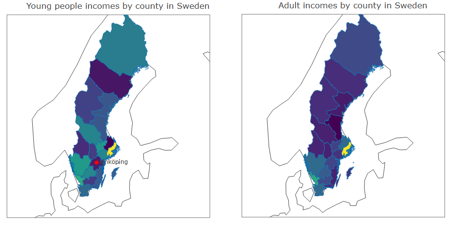
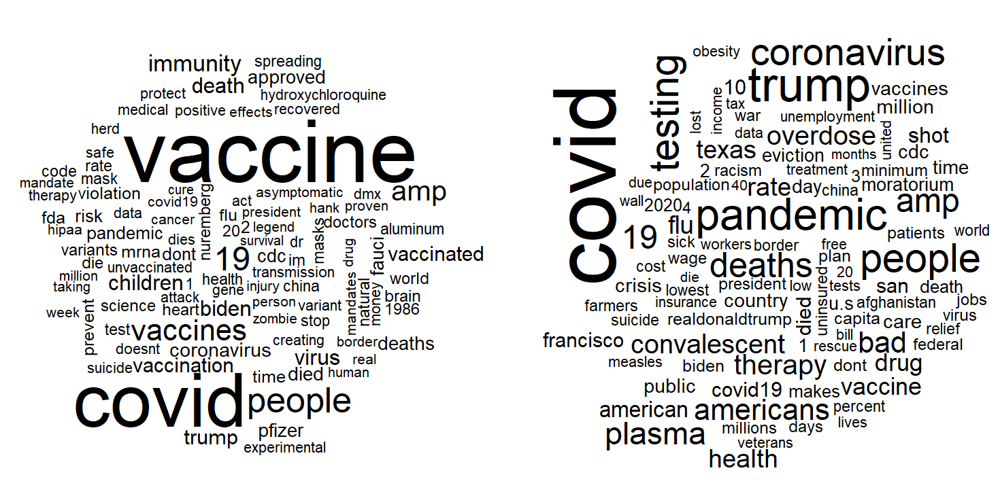
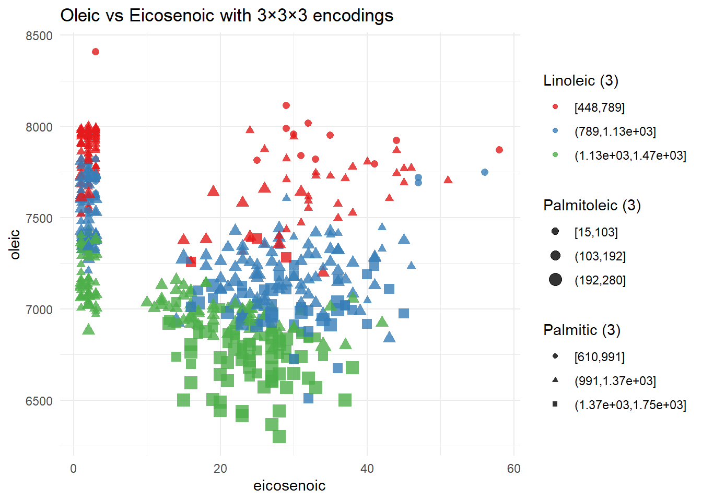
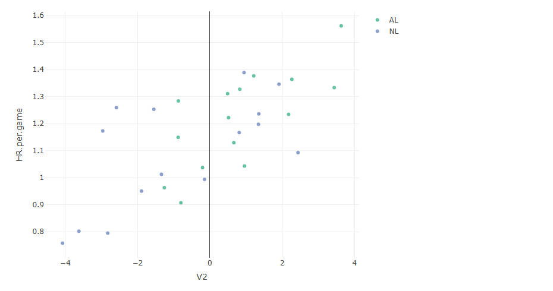
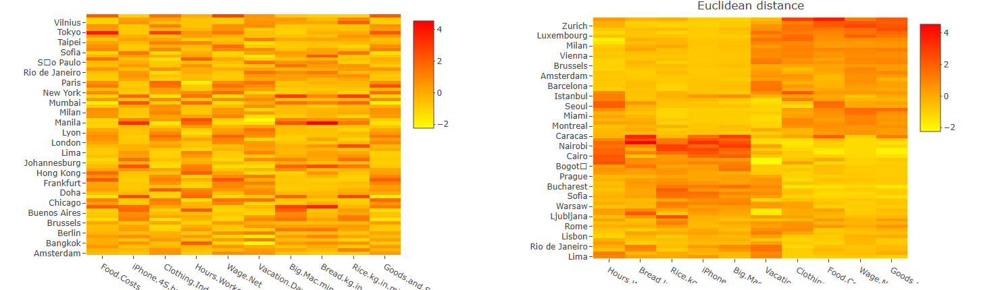
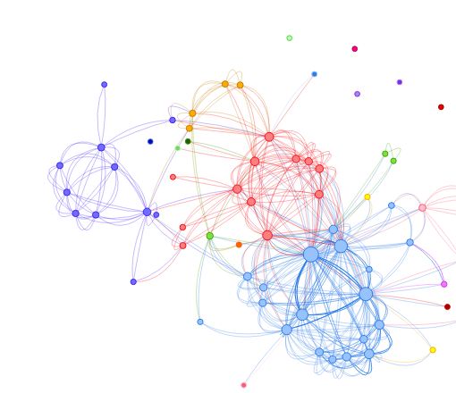

# Data Visualization Labs

Labs from a data visualization course taken during my MSc in Statistics and
Machine Learning at Linköping University (autumn 2025). All work in R.

Each `labN/` folder contains the assignments (`.R` / `.Rmd`), the knitted
HTML reports, and the course datasets.

## Reports (live, interactive)

The knitted reports keep their plotly / visNetwork interactivity (hover, zoom,
drag). Open them in the browser:

- [Lab 1 report](https://yiyang-09.github.io/vvisualization/lab1/lab1.html)
- [Lab 2 report](https://yiyang-09.github.io/vvisualization/lab2/lab2.html)
- [Lab 3 report](https://yiyang-09.github.io/vvisualization/lab3/lab3.html)

The images below are static previews.

## Lab 1

- **SENIC hospital data**: density estimation with adjustable bandwidth and
  IQR-based outlier flagging, wrapped in an interactive **Shiny** app
  (`shiny.R`, `assignment1_shiny.Rmd`).
- **Swedish regional incomes 2023**: interactive **choropleth maps** of
  Swedish regions using GADM GeoJSON with `plot_geo`, comparing income
  across age groups (`assignment2.Rmd`).
- **Tweet analysis**: word clouds, sentiment analysis, and an interactive
  **network graph** with `tidytext`, `wordcloud`, `ggraph`, `visNetwork`
  (`assignment3.Rmd`).

## Lab 2

- **Olive oil composition**: encoding-design experiments, using color vs.
  size vs. facets to carry the same variable, with ColorBrewer palettes and
  plotly interactivity (`assignment1.R`).
- **Baseball 2016**: **MDS** projection of team stats (`MASS`) with linked,
  hoverable plotly views colored by league (`assignment2.R`).

## Lab 3

- **Prices and earnings across cities**: plotly heatmap made readable by
  reordering rows and columns with **hierarchical clustering + seriation**
  (Euclidean and correlation distance) (`assignment1.R`).
- **Network data**: interactive network visualization with `igraph`,
  `visNetwork`, `ggraph`, plus a cluster-ordered heatmap (`assignment2.R`).

## Tools

R, ggplot2, plotly, Shiny, seriation, igraph / ggraph / visNetwork,
tidytext, MASS (MDS), dplyr / tidyr.
